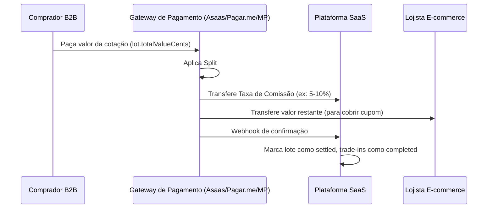

# Fase 5: B2B Clearing House / Repasse de Usados

## Visão Geral

Esta funcionalidade permite que lojistas de e-commerce repassem automaticamente os aparelhos recebidos via Trade-in para Empresas Recondicionadoras e Compradores B2B de Seminovo, sem precisar de estoque nem capital de giro.

## Arquitetura

### 1. Portal do Comprador B2B (Buyers Portal)

#### Cadastro e KYC
- **Endpoint**: `POST /api/b2b/buyer/register`
- **Campos**: companyName, cnpj, contactName, contactPhone, address
- **Status**: `pending_kyc` → `approved`/`rejected`/`suspended`
- **Modelo**: `B2BBuyer` vinculado ao `User` via Better Auth

#### Matriz de Compra (Dashboard)
- **Endpoint**: `POST /api/b2b/offers` - Criar oferta
- **Endpoint**: `GET /api/b2b/offers` - Listar ofertas
- **Campos da oferta**: brand, model, storage, conditionCriteria, maxPriceCents, minQuantity
- **Critérios de condição**: powers_on, screen_intact, battery_ok

### 2. Motor de Matching e Liquidação Automática

#### Algoritmo de Matching
Localizado em: `src/lib/b2b/matching.ts`

**Lógica:**
1. Busca Trade-ins com status `approved` e não repassados
2. Cruza com ofertas ativas de compradores aprovados
3. Filtra por: marca/modelo/armazenamento, status do comprador, validade da oferta
4. Valida preço (tradeIn.estimatedCents <= offer.maxPriceCents)
5. Valida critérios de condição conforme matriz do comprador
6. Seleciona melhor oferta por maior preço (melhor para o lojista)
7. Cria lote (`B2BLot`) se não existir lote aberto para o comprador
8. Atualiza TradeIn: atribui buyerId, offerId, lotId, status `sent_to_buyer`

**Auto-matching:**
- **Endpoint**: `POST /api/b2b/matching/auto`
- Executa matching para todos os trade-ins aprovados não repassados

#### Redirecionamento de Etiqueta
Quando o trade-in é repassado para o comprador B2B:
- A etiqueta de envio é gerada diretamente com o endereço do Comprador B2B
- Método: `PaymentSplitService.generateBuyerShippingLabel()`
- O aparelho vai direto do cliente final para o recondicionador/comprador B2B (pulando armazém da loja)

### 3. Split de Pagamento e Comissionamento

Localizado em: `src/lib/b2b/payment-split.ts`

#### Fluxo Financeiro



#### Cálculo do Split
```typescript
commissionCents = Math.round((buyerPaidCents * commissionRateBps) / 10000)
merchantPayoutCents = buyerPaidCents - commissionCents
```
- `commissionRateBps`: configurável por comprador (padrão 500 = 5%)
- Comissão fica com a plataforma SaaS
- Restante vai para o lojista (cobre o valor do cupom concedido ao cliente)

#### Endpoints
- **Criar pagamento**: `POST /api/b2b/payment/create` com `{ lotId }`
- **Webhook**: `POST /api/b2b/payment/webhook` com `{ paymentIntentId, status, chargeId }`

## Schema do Banco de Dados

### Novos Modelos

**B2BBuyer** - Cadastro de compradores B2B
```prisma
model B2BBuyer {
  id String @id @default(cuid())
  userId String @unique
  user User @relation(fields: [userId], references: [id])
  companyName String
  cnpj String? @unique
  contactName String
  contactPhone String
  address Json?
  status B2BBuyerStatus @default(pending_kyc)
  kycData Json?
  approvedAt DateTime?
  approvedBy String?
  notes String?
  commissionRateBps Int @default(500)
  offers B2BOffer[]
  lots B2BLot[]
  tradeIns TradeIn[]
  splitTransactions B2BSplitTransaction[]
}
```

**B2BOffer** - Matriz de compra por modelo/condição
```prisma
model B2BOffer {
  id String @id @default(cuid())
  buyerId String
  buyer B2BBuyer @relation(fields: [buyerId], references: [id])
  brand String
  model String
  storage String?
  conditionCriteria Json // {require_powers_on, require_screen_intact, require_battery_ok}
  maxPriceCents Int
  minQuantity Int @default(1)
  status B2BOfferStatus @default(active)
  expiresAt DateTime?
  tradeIns TradeIn[]
}
```

**B2BLot** - Agrupamento de aparelhos para um comprador
```prisma
model B2BLot {
  id String @id @default(cuid())
  buyerId String?
  buyer B2BBuyer? @relation(fields: [buyerId], references: [id])
  status B2BLotStatus @default(open)
  totalDevices Int @default(0)
  totalValueCents Int @default(0)
  settledAt DateTime?
  tradeIns TradeIn[]
  splitTransaction B2BSplitTransaction?
}
```

**B2BSplitTransaction** - Controle financeiro com split
```prisma
model B2BSplitTransaction {
  id String @id @default(cuid())
  lotId String @unique
  lot B2BLot @relation(fields: [lotId], references: [id])
  buyerId String
  buyer B2BBuyer @relation(fields: [buyerId], references: [id])
  paymentProvider String
  paymentIntentId String?
  chargeId String?
  buyerPaidCents Int
  commissionCents Int
  merchantPayoutCents Int
  commissionRateBps Int
  status B2BSplitStatus @default(pending)
  splitConfig Json?
  webhookData Json?
  paidAt DateTime?
  splitCompletedAt DateTime?
}
```

### Alterações em TradeIn
```prisma
model TradeIn {
  // ... campos existentes
  lotId String?
  lot B2BLot? @relation(fields: [lotId], references: [id])
  b2bBuyerId String?
  b2bBuyer B2BBuyer? @relation(fields: [b2bBuyerId], references: [id])
  b2bOfferId String?
  b2bOffer B2BOffer? @relation(fields: [b2bOfferId], references: [id])
  matchedAt DateTime?
  sentToBuyerAt DateTime?
}
```

### Novos Enums
- `B2BBuyerStatus`: pending_kyc, approved, rejected, suspended
- `B2BOfferStatus`: active, inactive, expired
- `B2BLotStatus`: open, closed, settled
- `B2BSplitStatus`: pending, paid, split_completed, failed, refunded
- `TradeStatus` (adicionados): sent_to_buyer, completed

## Integração com Gateway de Pagamento

Para produção, integrar com um dos seguintes:
- **Asaas**: Suporta split de pagamento nativo
- **Pagar.me**: Marketplace com split
- **Mercado Pago**: Split de pagamentos

A estrutura atual já está preparada para receber `paymentIntentId`, `chargeId` e `splitConfig` do gateway.

## Próximos Passos

1. Executar migração: `npx prisma migrate deploy` ou `npx prisma migrate dev`
2. Gerar cliente Prisma: `npx prisma generate`
3. Configurar gateway de pagamento com credenciais
4. Implementar aprovação KYC no painel admin
5. Configurar webhooks do gateway
6. Implementar geração real de etiquetas com Melhor Envio/Correios
