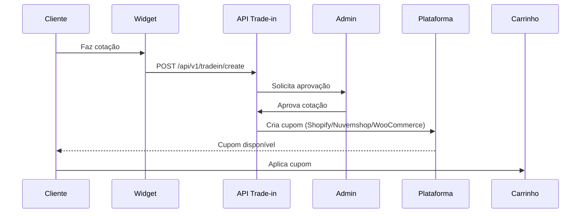

# Guia de Instalação Completo - Trade-in Widget Multi-plataforma

Este guia cobre a instalação e configuração do widget Trade-in em todas as 3 plataformas.

## Visão Geral do Fluxo

1. **Backend API** (já existe em `/app`) - Precisa estar acessível publicamente
2. **Plataforma** - Instalar app/plugin/script conforme plataforma
3. **Integração** - Cupons são criados automaticamente quando cotação aprovada
4. **Teste** - Validar em ambiente sandbox/dev

## 1. Preparação do Backend

O backend FastAPI já existe neste repositório. Você precisa expô-lo publicamente:

```bash
# Desenvolvimento com ngrok
ngrok http 8000

# Ou fazer deploy em Render/Heroku/Railway
```

Anote a URL: `https://seu-backend.ngrok-free.app`

## 2. Shopify

### 2.1 Criar App no Partner Dashboard
1. Acesse [shopify.dev/partners](https://shopify.dev/partners)
2. Apps > Criar app > Criar app manualmente
3. Anote API Key e API Secret

### 2.2 Configurar e fazer deploy
```bash
cd shopify
cp ../shared/env.example .env
# Preencher variáveis Shopify
npm install
shopify app dev  # Desenvolvimento
shopify app deploy  # Produção
```

### 2.3 Ativar Theme App Extension
1. Instalar app na loja de desenvolvimento
2. Ir em Personalizar tema
3. Adicionar bloco "Trade-in Widget" em Produto ou Carrinho
4. Configurar Store ID, API URL, etc.

### 2.4 Configurar Webhook para cupons
Na rota `app/routes/webhooks.tradein.approved.tsx`, configure para receber aprovação da API Trade-in.

## 3. Nuvemshop

### 3.1 Criar App
1. Acesse [partners.nuvemshop.com.br](https://partners.nuvemshop.com.br)
2. Criar novo aplicativo
3. Configurar URLs de autorização
4. Solicitar permissões: `write_scripts`, `write_coupons`, `read_products`

### 3.2 Deploy da integração
```bash
cd nuvemshop
# Deploy em Vercel/Heroku/etc
```

Configurar:
- `NUVEMSHOP_APP_ID`
- `NUVEMSHOP_APP_SECRET`
- `NUVEMSHOP_REDIRECT_URI`
- `TRADEIN_API_URL`

### 3.3 Testar instalação
1. Instalar app em loja de teste
2. OAuth deve redirecionar corretamente
3. Script deve ser injetado automaticamente via Scripts API
4. Widget deve aparecer em produto/carrinho

## 4. WooCommerce

### 4.1 Instalar plugin
```bash
cd woocommerce
# Compactar
zip -r tradein-widget.zip . -x "*.git*" "README.md"
```

Ou copiar diretamente:
```bash
cp -r woocommerce /path/to/wordpress/wp-content/plugins/tradein-widget
```

### 4.2 Ativar e configurar
1. WordPress Admin > Plugins > Ativar "Trade-in Widget for WooCommerce"
2. Trade-in Widget > Configurações
3. Preencher:
   - URL da API Trade-in
   - Store ID
   - Token Admin
   - Token API WordPress (gerar aleatório)
4. Salvar configurações

### 4.3 Configurar API Trade-in
Na API FastAPI, adicionar endpoint para chamar webhook WooCommerce:

```python
# app/main.py - adicionar
async def notify_woocommerce_approved(quote_id, coupon_code, amount):
    # Chamar POST /wp-json/tradein/v1/coupon/approve
    pass
```

## 5. Integração entre APIs

### Fluxo completo



### Configurar chamadas entre sistemas

**Shopify:** App chama `/api/coupons/create` internamente ou recebe webhook

**Nuvemshop:** API Trade-in chama `POST https://seu-nuvemshop-app.com/api/coupons/create` com Bearer token

**WooCommerce:** API Trade-in chama `POST https://seusite.com/wp-json/tradein/v1/coupon/approve` com Bearer token

## 6. Testes

### Checklist por plataforma

#### Shopify
- [ ] App instalado com sucesso
- [ ] Theme App Extension aparece no customizador
- [ ] Widget renderiza em PDP
- [ ] Widget renderiza no carrinho
- [ ] Cupom criado via GraphQL Admin API
- [ ] Cupom aplicável no checkout

#### Nuvemshop
- [ ] OAuth funciona
- [ ] Script injetado automaticamente
- [ ] Widget carrega em produto
- [ ] Widget carrega no carrinho
- [ ] Cupom criado via REST API
- [ ] Cupom válido

#### WooCommerce
- [ ] Plugin ativo sem erros
- [ ] Widget aparece antes do "Adicionar ao carrinho"
- [ ] Widget aparece no carrinho
- [ ] Cupom aplicado via `WC()->cart->add_discount()`
- [ ] Desconto aparece no carrinho
- [ ] Pedido finalizado com cupom

## 7. Troubleshooting

### Widget não aparece
- Verificar se script está carregando (DevTools Network)
- Verificar console por erros
- Confirmar API URL acessível
- Verificar se Web Component está definido

### Cupom não criado
- Verificar permissões (scopes/tokens)
- Verificar logs da API
- Confirmar tokens corretos
- Testar endpoint manualmente

### Cupom não aplicado no carrinho
- **WooCommerce:** Verificar sessão PHP, `WC()->session` ativo
- **Shopify:** Verificar se cupom é `DiscountCodeBasic` válido
- **Nuvemshop:** Verificar se cupom tem `valid: true`

## 8. Segurança

- Usar HTTPS em produção
- Rotacionar tokens regularmente
- Validar webhooks com assinaturas
- Limitar permissões ao mínimo necessário
- Não expor tokens no frontend
- Usar nonces/tokens para autenticação

## Suporte

Para dúvidas, consulte:
- [Shopify App Docs](https://shopify.dev/docs/apps)
- [Nuvemshop API Docs](https://api.nuvemshop.com.br/docs)
- [WooCommerce Docs](https://woocommerce.com/documentation/)

### Landing, plataforma e simulador

- `/`: landing pública com explicação do trade-in e simulador da loja `demo`.
- `/dashboard`: plataforma protegida por login. A aba **Simulador** abre uma vitrine de prévia em computador ou celular, com o catálogo e as regras da loja vinculada à conta. O botão **Abrir modo de teste** em **Integração** leva à mesma prévia. Nesse modo, a confirmação não envia dados de cliente nem cria solicitações; **Reiniciar teste** limpa o formulário.
- `/demo.html`: demonstração estática legada, mantida para compatibilidade.

O widget é compartilhado pelos dois ambientes. Edite `static/widget.js` e execute `npm run assets` dentro de `merchant` para atualizar a cópia pública (dev/build também sincronizam).

Antes de iniciar, use Node 22.12 ou superior e execute `npm run db:migrate` em `merchant`. A migração `202610260004_tradein_device_logistics` adiciona os campos de IMEI e logística usados ao confirmar a troca; sua ausência pode causar HTTP 500.

O IMEI entra na etapa de confirmação, depois da estimativa. É opcional nesta demonstração e, quando informado, passa pela validação de formato e dígito verificador. Fica disponível na inspeção. **Não há consulta real de bloqueio conectada**: `imeiChecked` permanece falso. Para operação real, integre um provedor autorizado, defina a obrigatoriedade conforme a categoria do aparelho e confira o IMEI físico antes de aprovar. Cupons e autorizações de postagem seguem simulados.

O botão **Preencher dados de teste** facilita testar o formulário sem dados pessoais reais. O consentimento precisa ser marcado separadamente. CPF, CEP e telefone aceitam pontuação, removida antes do envio; UF é convertida para maiúsculas. Erros de validação identificam o campo recusado.

A migração `202610260005_reconcile_b2b_schema` também reconcilia instalações onde a migração B2B foi marcada como aplicada sem criar seus objetos. Ela preserva os registros existentes e usa criação/adição condicional.

### Recarregamentos contínuos no desenvolvimento

Inicie a aplicação com `npm run dev` dentro de `merchant`. O script usa `next dev --webpack` para evitar o loop `HMR hash mismatch` observado com Turbopack neste ambiente. A atualização automática ao editar arquivos continua funcionando. Se houver um processo antigo iniciado com `next dev`, encerre-o antes de usar o script atualizado.
