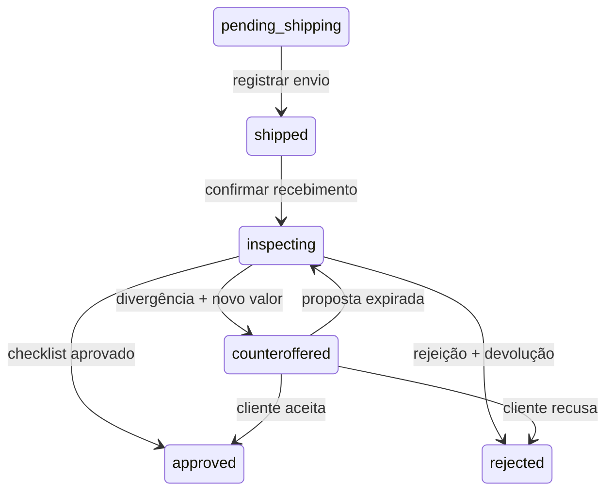

# Volta · Fase 2 — Dashboard do lojista

Aplicação Next.js 16 / React 19, TypeScript, Tailwind 4, componentes no padrão shadcn/ui (Button com Radix Slot, Input e Card), Better Auth e Prisma 7 sobre PostgreSQL. Inclui dashboard, API REST, migrations, seed, widget da Fase 1 e página de aceite de contraproposta.

## Executar com PostgreSQL

```sh
cd merchant
nvm use
npm ci
cp .env.example .env
```

Em `.env`, defina um `BETTER_AUTH_SECRET` aleatório de pelo menos 32 caracteres e as credenciais `SEED_EMAIL` / `SEED_PASSWORD` (mínimo 12 caracteres). Não use os textos de exemplo em produção. Gere um segredo com `openssl rand -hex 32`.

```sh
docker compose up -d db
npm run db:generate
npm run db:migrate
npm run db:seed
npm run dev
```

- Dashboard: http://localhost:3000/dashboard
- Login: http://localhost:3000/login (credenciais definidas no seed).
- Landing + widget: http://localhost:3000/demo.html
- O cadastro público está desabilitado; o seed cria uma conta vinculada à loja `demo`.
- O seed é repetível e não sobrescreve configurações, preços nem senha existentes.
- Se a porta estiver ocupada, ajuste `BETTER_AUTH_URL` e `ALLOWED_ORIGINS`, e use `npm run dev -- --port 3100`.

### Alternativa local usada nesta entrega

O PostgreSQL nativo da máquina apresentou uma biblioteca ausente. A validação usa **PGlite**, PostgreSQL em WebAssembly, por TCP local. A `.env` local criada nesta sessão aponta para `127.0.0.1:55432`, com `PG_POOL_MAX=1`, e usa `BETTER_AUTH_URL=http://127.0.0.1:3100`. Credenciais aleatórias estão nessa `.env` ignorada pelo Git.

```sh
# Terminal 1, dentro de merchant/
npm run test:db
# Terminal 2
npm run db:generate
npm run db:migrate
npm run db:seed
npm run dev -- --hostname 127.0.0.1 --port 3100
```

Abra http://127.0.0.1:3100/dashboard. O banco de teste é persistido em `/private/tmp/volta-merchant-pglite` por padrão; altere com `TEST_DB_DIR`. PGlite não substitui a validação de concorrência e operação em PostgreSQL nativo. O servidor de testes não deve ser exposto externamente.

## Organização

```text
merchant/
  prisma/
    schema.prisma                 # Entidades, relações, enums e índices
    migrations/                   # DDL PostgreSQL + CHECK constraints
    seed.ts                       # Lojas, aparelhos, regras e login local
  src/
    app/
      dashboard/page.tsx          # Entrada protegida por sessão
      login/page.tsx              # Login Better Auth
      offer/page.tsx              # Aceite/recusa do cliente via link
      api/auth/[...all]/route.ts  # Sessões e autenticação
      api/[...path]/route.ts      # Endpoints REST
    components/
      dashboard.tsx              # Navegação, solicitações e eventos
      settings-panel.tsx         # Modalidade, frete, margem e pagamento
      pricing-panel.tsx          # CRUD e abatimentos
      inspection-panel.tsx       # Declaração, checklist e decisões
      ui/                        # Primitivos reutilizáveis Tailwind/Radix
    lib/
      auth.ts                    # Better Auth + Prisma adapter
      api.ts                     # Roteamento, autorização e validação
      domain.ts                  # Schemas Zod e cálculo monetário
      service.ts                 # Transações e máquina de estados
      outbox.ts                  # Entregas e retentativas
      db.ts                      # Pool PostgreSQL e Prisma Client
  scripts/
    sync-assets.mjs              # Copia landing/widget da Fase 1
    worker.ts                    # Reprocessa eventos pendentes/falhos
    test-db.ts                   # PostgreSQL embarcado para testes
  tests/                         # Testes unitários e Playwright
  compose.yaml                   # PostgreSQL 17
```

O código Python original continua disponível. A Fase 2 usa **banco próprio**; o SQLite da Fase 1 não é alterado ou importado automaticamente. Para as configurações do dashboard afetarem uma loja, seu widget precisa apontar para a **API Next.js**:

```html
<script defer src="http://localhost:3000/widget.js"></script>
<trade-in-widget
  api-url="http://localhost:3000"
  store-id="demo"
></trade-in-widget>
```

Em produção, use HTTPS e configure as origens permitidas. Os contratos `/api/v1/devices`, `/api/v1/quotes/calculate`, `/api/v1/tradein/create` e `/api/v1/leads` continuam compatíveis com a Fase 1.

## Banco e isolamento

- **Store**: modalidade, responsável e custo de frete, margem em basis points, pagamento (`coupon` ou `pix`), versão.
- **Membership**: usuário, loja e perfil (`owner` ou `technician`). O MVP vincula uma loja por conta na navegação; não há seletor multilojas.
- **Device / ConditionRule**: catálogo e regras específicos de cada loja. Exclusão de aparelho é arquivamento, preservando o histórico; é possível reativá-lo na edição.
- **TradeIn**: cliente, condição declarada, snapshot da composição da cotação, modalidade e pagamento contratados, valores, códigos, pré-autorização simulada, status e versão.
- **Inspection**: checklist, técnico, decisão, parecer e data. Registro criado na mesma transação da decisão.
- **Counteroffer**: valor, motivo, hash do token, validade de sete dias e aceite/recusa.
- **OutboxEvent**: evento e payload, tentativas, próxima execução, erro e confirmação de entrega.
- **User / Session / Account / Verification / RateLimit**: autenticação Better Auth. Senhas são armazenadas por hash; cookies de sessão são geridos pela biblioteca.

Toda consulta administrativa é limitada à loja da sessão, nunca ao `store_id` recebido do cliente. Técnicos podem inspecionar; preços/configurações são restritos ao responsável. Mutações exigem a origem do dashboard. Cookies e rate limit de login são persistidos. Requisições públicas do widget não recebem dados pessoais de outras solicitações.

## Cotação e regras

Valores monetários são inteiros em centavos; percentuais são basis points (`1500 = 15%`).

1. Somar abatimentos negativos sobre o preço base, limitados a 100%.
2. Aplicar a margem global sobre o valor após abatimentos.
3. Descontar o frete somente quando o cliente o custeia.
4. Arredondar em centavos e limitar o resultado a zero; criações sem valor são recusadas.

Exemplo: R$ 1.800 − 30% de tela = R$ 1.260; margem de 10% = R$ 126; frete de R$ 25 → **R$ 1.109**.

O valor é recalculado na criação. Alterar preços/regras não muda solicitações existentes. O widget só aceita aparelhos ativos. O modo instantâneo permite escolher cupom imediato ou pós-inspeção; lojas pós-inspeção não permitem antecipação. PIX é restrito ao pós-inspeção.

## API REST

Os endpoints administrativos requerem cookie de sessão. Corpos não documentados e campos extras são rejeitados. As mutações com `version` retornam **409** se outro operador tiver alterado o registro. Use a versão retornada pela leitura mais recente.

| Método         | Endpoint                                          | Função                                 |
| -------------- | ------------------------------------------------- | -------------------------------------- |
| GET            | `/api/merchant/me`                                | Loja, usuário e perfil da sessão       |
| GET / PATCH    | `/api/merchant/settings`                          | Configurações da loja                  |
| GET            | `/api/merchant/devices?q=iphone`                  | Buscar marca/modelo/capacidade         |
| POST           | `/api/merchant/devices`                           | Criar aparelho                         |
| PATCH / DELETE | `/api/merchant/devices/:id`                       | Atualizar / arquivar aparelho          |
| GET            | `/api/merchant/rules`                             | Regras de abatimento                   |
| PATCH          | `/api/merchant/rules/:id`                         | Atualizar percentual                   |
| GET            | `/api/merchant/tradeins?status=inspecting&page=1` | Lista paginada, totais e contagens     |
| GET            | `/api/merchant/tradeins/:id`                      | Declaração, inspeções e eventos        |
| PATCH          | `/api/merchant/tradeins/:id/status`               | Registrar envio ou recebimento         |
| GET            | `/api/merchant/tradeins/:id/return-label`         | Prévia imprimível da etiqueta simulada |
| POST           | `/api/merchant/tradeins/:id/inspection`           | Aprovar, contrapor ou rejeitar         |
| GET            | `/api/merchant/events`                            | Últimos 100 eventos da loja            |
| POST           | `/api/merchant/events/retry`                      | Reagendar entregas falhas              |
| POST           | `/api/offers/view`                                | Exibir proposta com token do link      |
| POST           | `/api/offers/respond`                             | Aceitar ou recusar proposta            |

Configuração (`PATCH /api/merchant/settings`):

```json
{
  "mode": "post_inspection",
  "freightPayer": "customer",
  "freightCents": 2500,
  "marginBps": 1000,
  "payoutMethod": "coupon",
  "version": 0
}
```

Aparelho (`POST`; para `PATCH`, acrescente `version`):

```json
{
  "brand": "Apple",
  "model": "iPhone 13",
  "storage": "128GB",
  "basePriceCents": 180000,
  "active": true
}
```

Arquivamento: `{"version":0}`. Regra: `{"deductionBps":3000,"version":0}`. Status: `{"status":"shipped","version":0}` ou `{"status":"inspecting","version":1}`.

Vistoria:

```json
{
  "version": 2,
  "decision": "counteroffer",
  "checklist": {
    "powersOn": true,
    "imeiMatches": true,
    "conditionMatches": false
  },
  "notes": "A tela apresenta trincas não declaradas pelo cliente.",
  "amountCents": 100000
}
```

`approve` exige todos os itens confirmados. `counteroffer` exige valor positivo menor que a cotação original e motivo de pelo menos dez caracteres. `reject` exige motivo. Para contrapropostas expiradas, o dashboard permite retomar a inspeção antes de decidir pela devolução (`status: "reopen_inspection"`).

Resposta do cliente: `{"token":"<token de 64 caracteres do link>","accept":true}`. O token fica no fragmento da URL, evitando acesso por simples GET de robôs de e-mail, e apenas seu hash fica na tabela de propostas. O link original aparece no evento de notificação, acessível somente à loja. Respostas repetidas retornam 409 e expiradas retornam 410.

## Inspeção e integrações



As decisões e eventos são gravados em uma transação. O outbox dispara após a resposta HTTP e pode ser reprocessado com `npm run worker` (agende periodicamente no ambiente operacional). A trava de versão impede decisão duplicada; a criação pública usa `Idempotency-Key`. Eventos têm entrega **pelo menos uma vez**: consumidores devem deduplicar por ID.

### O que é simulado

`INTEGRATION_MODE=mock` é o padrão. A aplicação registra a pré-autorização antes de criar o cupom instantâneo; aprovação libera cupom/PIX simulado, rejeição revoga o cupom e cria código de devolução simulado; contraproposta cria uma notificação endereçada a e-mail/WhatsApp com o link de aceite. Nada é cobrado, pago, enviado por mensagem ou postado de verdade. Todos os códigos usam `DEMO-` e os payloads indicam `simulated: true`.

A aba **Eventos** permite inspecionar a mensagem, abrir o aceite do cliente e acompanhar falhas. Assim, o fluxo completo pode ser testado sem contas externas.

### Webhook de saída

Com `INTEGRATION_MODE=webhook`, `INTEGRATION_WEBHOOK_URL` (HTTPS) e `INTEGRATION_WEBHOOK_SECRET`, o outbox encaminha os eventos ao gateway configurado. Eles continuam contendo códigos simulados: este conector é a fronteira de integração, não um provedor financeiro, de frete ou de mensagens pronto.

- Corpo: `{id, type, storeId, tradeInId, payload}`.
- Cabeçalho `Idempotency-Key`: ID do evento.
- `X-Volta-Timestamp`: epoch em milissegundos.
- `X-Volta-Signature`: HMAC-SHA256 hexadecimal de `${timestamp}.${corpoJSON}`.
- Eventos: `tradein.created`, `tradein.approved`, `tradein.counteroffered`, `tradein.rejected`.
- Retentativas com backoff até uma hora; timeout de dez segundos; redirects não são seguidos.

Para operação real, implemente os adaptadores de concessão/PIX, pré-autorização tokenizada, frete e mensagens, valide resultados e faça reconciliação. Credenciais ficam no servidor. Um cupom já consumido não pode ser “desfeito” apenas limpando o banco: essa situação precisa de tratamento comercial e do provedor. `approved` descreve a decisão da vistoria; o status do evento mostra se a integração foi entregue.

## Verificação

```sh
npm test
npm run typecheck
npm run build -- --webpack
# Com servidor e banco de testes em execução:
npx playwright install chromium
npm run test:e2e
```

A suíte usa dados fictícios e altera o banco configurado; execute-a apenas no banco de desenvolvimento/teste. Se já houver Chromium instalado, defina `PLAYWRIGHT_CHROMIUM_EXECUTABLE` para seu executável.

Referências: [Prisma 7](https://www.prisma.io/docs/orm/v7), [Next.js cookies](https://nextjs.org/docs/app/api-reference/functions/cookies), [PGlite Socket](https://pglite.dev/docs/pglite-socket).

## Novas Funcionalidades - Logística Reversa e Antifraude

### Validação de IMEI e Segurança
- **IMEIService** (`src/lib/imei.ts`): Valida formato e algoritmo Luhn do IMEI
- **Endpoint**: `POST /api/v1/imei/validate` - Consulta blacklist de perda/roubo/furto (simulado)
- Bloqueia geração de cupom caso IMEI esteja na blacklist

### Logística Reversa
- **ShippingService** (`src/lib/shipping-reverse.ts`): Integração com Correios CWS, Melhor Envio ou Frenet
- Gera automaticamente Autorização de Postagem no momento da cotação/conclusão
- Retorna Código de Postagem de Logística Reversa e Etiqueta em PDF
- **Endpoint**: `GET /api/v1/shipping/label/[authCode].pdf` - Download da etiqueta

### Webhooks de Rastreamento
- **Endpoint**: `POST /api/v1/webhooks/shipping-status`
  - `POSTADO` → Notifica lojista que pacote está em trânsito
  - `ENTREGUE` → Altera status para "Pronto para Vistoria" e envia alerta WhatsApp do técnico

### Upload de Fotos e Comprovação Prévia
- **Component**: Upload direto para S3/Cloudflare R2 com URLs pré-assinadas
- **Endpoints**:
  - `POST /api/v1/uploads/presign` - Gera URL pré-assinada para upload
  - `POST /api/v1/uploads/confirm` - Confirma upload e salva URLs
- Exige 3 fotos obrigatórias: Tela ligada, Traseira, Lateral
